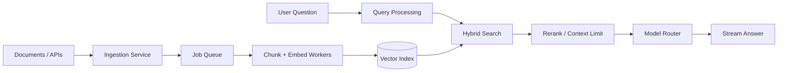
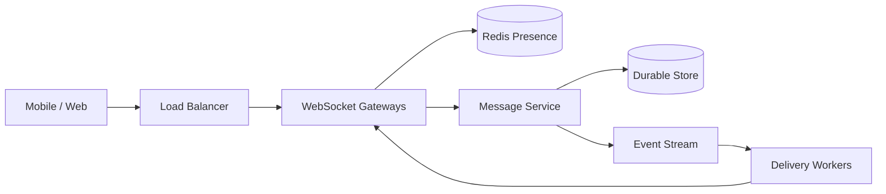
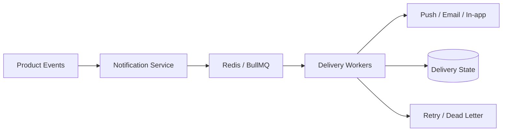

<div align="center">


[](https://github.com/flutter-create-ani)
[](https://leetcode.com/u/anie25/)
[](https://github.com/flutter-create-ani/go_learning)


</div>

---

## ⚡ Engineering at a glance

<table>
<tr>
<td width="50%" valign="top">

### 👨‍💻 Who I am

Full Stack Developer and Software Development Engineer building **web applications, backend services, real-time communication, and AI-powered workflows**.

- 🏢 **SDE I · ARM Worldwide**
- 🧩 Previously **Broki Services** and **Specstem Digital**
- 🔭 Interested in system design, distributed systems, RAG and reliability
- 🌱 Learning **Go** and production engineering
- 🧠 Solving algorithms on [LeetCode](https://leetcode.com/u/anie25/)

</td>
<td width="50%" valign="top">

### 🎯 How I engineer

```text
Understand the product
        ↓
Model data and failure cases
        ↓
Ship the simplest sound design
        ↓
Measure p95 / p99 and errors
        ↓
Scale the proven bottleneck
```

**Principle:** Correctness first. Observability always. Complexity only when justified.

</td>
</tr>
</table>

## 🧰 Technology radar

<div align="center">

**Languages & frontend**


**Backend, data & infrastructure**


`Kafka` · `BullMQ` · `RabbitMQ` · `Socket.IO` · `WebRTC` · `LiveKit` · `LangChain` · `RAG` · `MCP` · `Vector Search` · `REST APIs`

</div>

## 📈 Live engineering activity

<div align="center">


</div>

<sub>GitHub cards are provided by external services and may occasionally fail or display cached data. Language statistics reflect public repository contents, not engineering proficiency.</sub>

## 🐍 LeetCode activity — an animated submission calendar

<div align="center">

<a href="https://leetcode.com/u/anie25/"></a>

<picture>
  <source media="(prefers-color-scheme: dark)" srcset="https://raw.githubusercontent.com/flutter-create-ani/flutter-create-ani/output/leetcode-snake-dark.svg" />
  <source media="(prefers-color-scheme: light)" srcset="https://raw.githubusercontent.com/flutter-create-ani/flutter-create-ani/output/leetcode-snake.svg" />
  
</picture>

</div>

<details>
<summary><b>ℹ️ How this animation stays updated</b></summary>

The [`leetcode-snake.yml`](.github/workflows/leetcode-snake.yml) workflow runs the [generator](scripts/generate.py) and publishes its SVG output to the `output` branch. The image only renders after a successful workflow run. This animation represents **LeetCode submissions**, not GitHub commits; it is a custom visualization rather than the original `Platane/snk` algorithm.

The source of truth for solved problems is the [LeetCode profile](https://leetcode.com/u/anie25/). The generator depends on access to LeetCode activity data.

</details>

## 🚀 Selected engineering work

| Product / team | Focus | Technology / patterns |
| :--- | :--- | :--- |
| **ARM Worldwide · Luminary** | Full-stack AI workflows and multi-model orchestration | Next.js, React, Node.js, LLM routing |
| **Komorebi.fit** | Wearable integration, sync, notifications | Terra API, Redis, BullMQ, background processing |
| **Broki Services · CallHQ.ai** | CRM automation, AI integrations and backend optimization | Node.js, RAG, FastAPI, GCP Cloud Run |
| **Specstem Digital** | Backend APIs and asynchronous processing | Express, AWS, BullMQ |

> These are summaries of my contributions and technologies, not disclosures of proprietary system internals.

## 🧠 Systems design playground

I document architecture by starting with **requirements and failure modes**, then comparing simpler and more scalable alternatives.

<details open>
<summary><b>01 · Retrieval-Augmented Generation — asynchronous ingestion and retrieval</b></summary>



| Decision | Benefit | Cost / risk |
| :--- | :--- | :--- |
| Queue ingestion | Handles spikes, retries | Index freshness lag |
| Hybrid retrieval | Better lexical + semantic recall | More tuning and infrastructure |
| Reranking | Better context relevance | Added latency and cost |
| Model routing | Latency/cost control | Fallback and evaluation complexity |

**Measure:** retrieval recall, grounded answer quality, token cost, queue age, p95 end-to-end latency.

</details>

<details>
<summary><b>02 · Real-time messaging — connections, persistence and fan-out</b></summary>



**Design choices:** Persist messages before acknowledging durable delivery; use message IDs for deduplication; treat presence as ephemeral; use backpressure and reconnect/resume logic. Redis helps with transient coordination, not as the sole source of durable messages.

**Measure:** active connections, reconnect rate, delivery lag, dropped events and p99 send-to-receive latency.

</details>

<details>
<summary><b>03 · Notification pipeline — bursts, retries and idempotency</b></summary>



**Design choices:** Queue bursts to protect downstream providers; enforce user preferences before sending; use deduplication keys; bound retry attempts; monitor dead-letter queues and provider failures.

**Measure:** queue lag, duplicate-send rate, delivery success rate, p95 processing latency.

</details>

<details>
<summary><b>04 · System design checklist — my trade-off framework</b></summary>

| Dimension | Questions I ask |
| :--- | :--- |
| **Correctness** | What must be atomic? What can be eventually consistent? |
| **Load** | Read/write ratio? Peak concurrency? Hot keys? |
| **Data** | SQL vs document store? Index strategy? Retention? |
| **Reliability** | Timeouts? Retries? Idempotency? Failure isolation? |
| **Observability** | Logs, metrics, traces, SLOs and alert thresholds? |
| **Cost** | Can we scale workers before adding more services? |

</details>

<sub>Architecture diagrams are illustrative reference designs and are not claims about internal production deployments.</sub>

## 🧪 Building in public

<div align="center">

<a href="https://github.com/flutter-create-ani/go_learning">
  
</a>

**Current focus:** Go · production engineering · observability · distributed systems · algorithmic problem solving

</div>

## 🤝 Connect

<div align="center">

[](https://github.com/flutter-create-ani?tab=repositories)
[](https://leetcode.com/u/anie25/)

**Build simply · Measure carefully · Scale deliberately**


</div>
