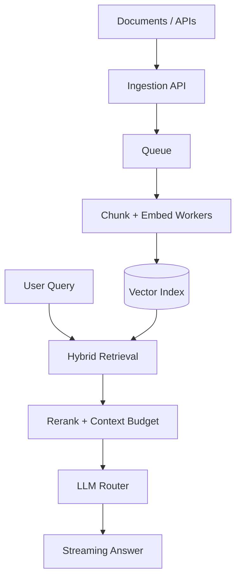
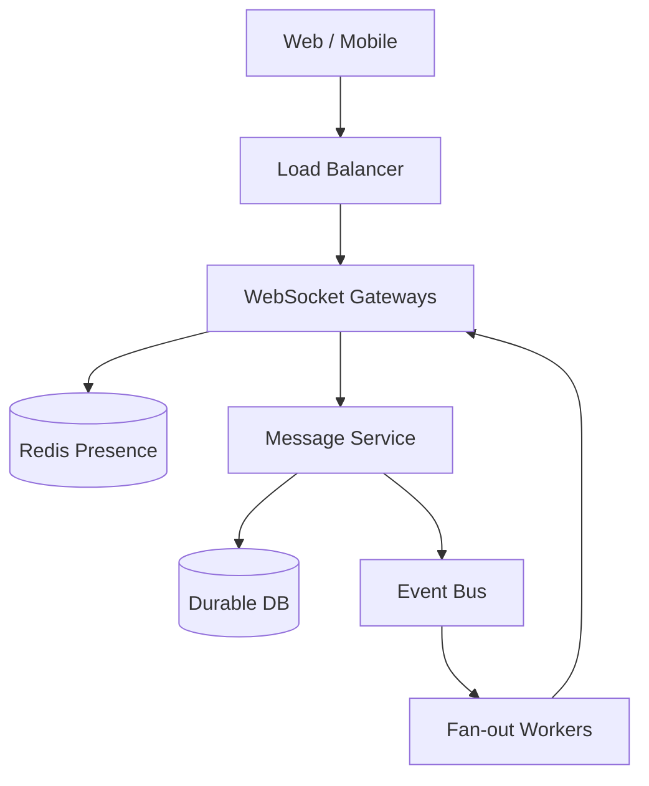
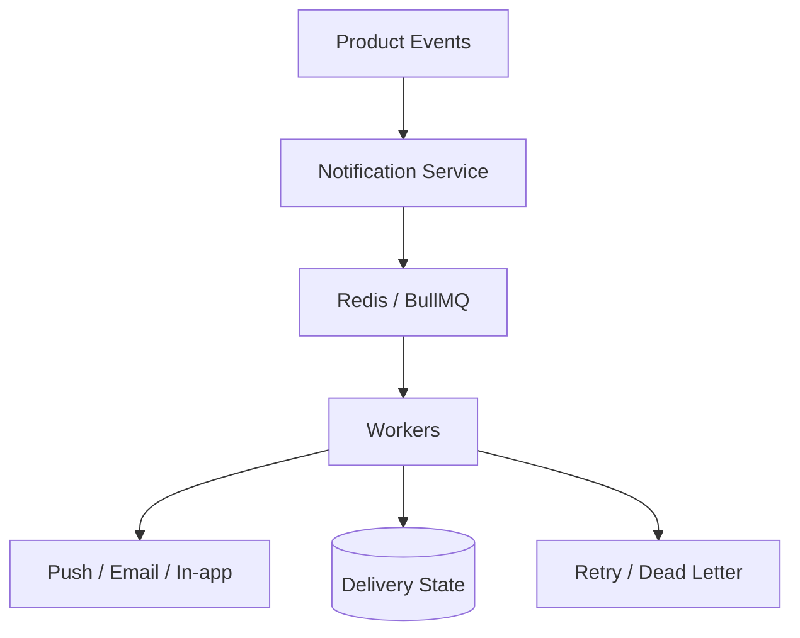

---

## 👋 About me

**Full Stack Developer · Software Development Engineer I at ARM Worldwide**

I build end-to-end products: user interfaces, APIs, AI workflows, background jobs and real-time communication systems. I care about **correctness, observability, latency and deliberate scaling**.

- 🏢 Previously: **Broki Services** and **Specstem Digital**
- 🧠 Interested in **distributed systems, RAG, WebRTC and reliability**
- 🌱 Learning **Go**, SRE and production engineering
- 🎯 Practicing DSA on **[LeetCode · aniec25](https://leetcode.com/u/aniec25/)**

> **How I work:** Understand requirements → model failure modes → ship the simplest sound design → measure → optimize → document trade-offs.

## 🧰 Tech stack

**Languages**

**Frontend & mobile**

**Backend & data**

**Cloud & delivery**

**Other tools:** `Kafka` · `BullMQ` · `RabbitMQ` · `Socket.IO` · `WebRTC` · `LiveKit` · `LangChain` · `RAG` · `Vector Search` · `MCP`

## 📈 Engineering activity

> GitHub's native contribution calendar can show eligible public **and private contribution counts** when enabled in your GitHub settings. Public stats cards cannot reliably include private contributions without authenticated access. The cards above are hosted by third parties and may occasionally fail.

<!-- If you set up a separate authenticated GitHub metrics workflow that writes github-metrics.svg to main, uncomment this line:

-->

## 🐍 LeetCode submission snake

<picture>
  <source media="(prefers-color-scheme: dark)" srcset="https://raw.githubusercontent.com/flutter-create-ani/flutter-create-ani/output/leetcode-snake-dark.svg" />
  <source media="(prefers-color-scheme: light)" srcset="https://raw.githubusercontent.com/flutter-create-ani/flutter-create-ani/output/leetcode-snake.svg" />
  
</picture>

<b>How the snake stays updated</b>

Your [LeetCode workflow](.github/workflows/leetcode-snake.yml) should run [`scripts/generate.py`](scripts/generate.py) with `LEETCODE_USERNAME: aniec25`, then publish `leetcode-snake.svg` and `leetcode-snake-dark.svg` to the `output` branch. The animation only displays after successful generation and publication. This is a custom LeetCode activity animation, not the GitHub `Platane/snk` contribution snake.

## 🚀 Selected engineering work

### 🤖 Luminary · ARM Worldwide

Full-stack AI workflows and multi-model orchestration.

`Next.js` · `React` · `Node.js` · `LLM routing`

### 🏃 Komorebi.fit

Wearable integrations, device sync and notification processing.

`Terra API` · `Redis` · `BullMQ` · `Background jobs`

### 📞 CallHQ.ai · Broki Services

CRM automation, AI integrations and backend improvements.

`Node.js` · `RAG` · `FastAPI` · `Cloud Run`

### ⚙️ Specstem Digital

Backend APIs and asynchronous processing.

`Express` · `AWS` · `BullMQ`

> These are high-level descriptions of my work, not disclosures of proprietary production architecture.

## 🏗️ System design lab

Architecture is about **trade-offs**, not collecting infrastructure components. Expand a design below to see the approach and reasoning.

<b>01 · Scalable RAG: ingestion to answer</b>

**Why this design?** Queues absorb ingestion spikes and support retries. Hybrid retrieval combines keyword and semantic matching. Reranking improves relevance but adds latency. Model routing can balance cost and quality but complicates fallbacks.

**Watch:** recall, grounded-answer quality, queue lag, token cost, p95 latency.

<b>02 · Real-time messaging: durable delivery</b>

**Why this design?** WebSockets support low-latency communication but need reconnect handling. Presence can be ephemeral; messages need durable persistence. Use message IDs, acknowledgements, idempotency and backpressure.

**Watch:** connection count, reconnect rate, p99 delivery latency, dropped events.

<b>03 · Notifications: burst handling</b>

**Why this design?** Queues absorb bursts but make delivery asynchronous. Apply user preferences, idempotency keys, bounded retries and provider-specific rate limits.

**Watch:** queue age, success rate, duplicates, p95 delivery time.

<b>04 · My production design checklist</b>

- **Correctness:** Which writes must be atomic? Where is eventual consistency acceptable?
- **Traffic:** Peak QPS, read/write ratio, concurrency and hot keys?
- **Data:** Schema, indexes, retention and migration strategy?
- **Reliability:** Timeouts, retries, idempotency and failure isolation?
- **Observability:** Metrics, traces, logs, SLOs and alerts?
- **Cost:** Can simpler scaling solve the bottleneck first?

Diagrams are illustrative reference architectures, not verified internal deployments of any employer.

## 🧪 Learning in public

**Go · Production Engineering · Observability · Distributed Systems · Algorithms**

---

## 🌐 Featured personal websites

### 🎮 GS Esports

**Esports, competitive gaming and community experiences**

### 🧪 PieNot Labs

**Personal web project**

> GitHub strips `<iframe>` elements from README files. These are responsive clickable previews, dependent on an external screenshot service. See [`websites.html`](websites.html) for a responsive iframe gallery suitable for a separate hosted page; each site may block iframe embedding.

---

**Build simply · Measure carefully · Scale deliberately**

