  

  <a href="https://www.linkedin.com/in/aniket-kumar-545282228/">LinkedIn</a> &nbsp; / &nbsp;
  <a href="https://leetcode.com/u/aniec25/">LeetCode</a> &nbsp; / &nbsp;
  <a href="mailto:aniket8227916940@gmail.com">Email</a> &nbsp; / &nbsp;
  <a href="https://github.com/flutter-create-ani?tab=repositories">Repositories</a>

### Building complete products, from interface to infrastructure.

I'm **Aniket Kumar**, a **Full Stack Developer** working at **ARM Worldwide**. I build complete web and mobile products—from responsive interfaces with React, Next.js, and Flutter to APIs, databases, real-time communication, and cloud infrastructure.

My work includes multi-LLM orchestration, health-data integrations, distributed WebSockets, and production notification systems. I enjoy turning a product requirement into software that is understandable, reliable, and ready to evolve.

<table>
  <tr>
    <td width="33%" align="center"><h3>20,000+</h3>Users reached by a Redis + BullMQ notification system</td>
    <td width="33%" align="center"><h3>70%</h3>Less manual work through internal CRM automation</td>
    <td width="33%" align="center"><h3>75 ms</h3>Reduction in API response time through backend optimization</td>
  </tr>
</table>

## 01 / Engineering focus

| Area | What I work on |
| :--- | :--- |
| **Frontend & mobile** | Responsive interfaces, dashboards, onboarding flows, state management, and cross-platform apps |
| **Backend & data** | REST APIs, authentication, RBAC, caching, indexing, query optimization, and asynchronous processing |
| **Real-time systems** | WebSocket communication, Redis Pub/Sub, Socket.IO adapters, WebRTC, and location-based discovery |
| **Applied AI** | RAG pipelines, multi-provider LLM orchestration, MCP integrations, and workflow automation |
| **Product delivery** | React and Next.js web apps, Flutter mobile apps, cloud deployments, and CI/CD |

## 02 / Experience

### ARM Worldwide · Software Development Engineer I
**Jun 2026 — Present**

- Shipped **Luminary** with a seven-member engineering team using Next.js, React, and Node.js.
- Designed multi-LLM orchestration using **Factory and Strategy patterns** for runtime provider selection.
- Integrated the **Terra API** for smartwatch health-data aggregation in Komorebi.
- Built notification delivery with **Redis, BullMQ, and Firebase Cloud Messaging** and distributed WebSocket communication using the Redis Adapter.

### Broki Services · Software Engineer
**Oct 2024 — Jun 2026**

- Developed **CallHQ.ai** across its landing page, dashboard, and Node.js/Express backend.
- Built a **LangChain + FastAPI RAG pipeline** and an internal CRM that reduced manual operations.
- Improved API performance through caching, indexing, and query optimization; deployed services on **GCP Cloud Run**.

### Specstem Digital · Backend Developer Intern
**Nov 2023 — Feb 2024**

- Developed REST APIs serving **500+ concurrent users** with optimized database access.
- Implemented **JWT authentication and fine-grained RBAC**.

## 03 / Technology toolkit

| Layer | Technologies |
| :--- | :--- |
| **Languages** | JavaScript · TypeScript · Java · Python · Dart · SQL |
| **Backend** | Node.js · Express · FastAPI · REST APIs · JWT · RBAC |
| **Web & mobile** | React · Next.js · Flutter · Tailwind CSS · Material UI · Framer Motion · MobX |
| **Databases** | PostgreSQL · MySQL · MongoDB / Mongoose · Firestore · Firebase Realtime Database |
| **Messaging & real-time** | Redis · BullMQ · RabbitMQ · Kafka · Socket.IO · WebRTC · LiveKit |
| **AI & automation** | LangChain · RAG · MCP · OpenAI API · Gemini · Claude · n8n |
| **AWS** | EC2 · S3 · IAM · SES · SNS · CloudFront · RDS · KMS |
| **Cloud & delivery** | GCP Cloud Run · Docker · GitHub Actions · Nginx · PM2 · Vercel · Netlify |
| **Tools & design** | Git · Swagger / OpenAPI · Figma · Cursor |

**Currently learning:** Go—building up the fundamentals through daily practice. Also exploring production engineering: observability, reliability, and system performance.

## 04 / Selected work

<table>
  <tr>
    <td width="50%" valign="top">
      <h3><a href="https://github.com/flutter-create-ani/TheInfluencer">TheInfluencer</a></h3>
      
Influencer marketing platform work spanning product experiences, backend services, and analytics.

      
React · Node.js · MongoDB · AWS · GCP

    </td>
    <td width="50%" valign="top">
      <h3><a href="https://github.com/flutter-create-ani/ENV-Interview">ENV Interview</a></h3>
      
An interview product with a React interface, onboarding flows, and resume preview experiences.

      
React · Material UI · Tailwind CSS

    </td>
  </tr>
  <tr>
    <td width="50%" valign="top">
      <h3><a href="https://github.com/flutter-create-ani/rag-pipeline">AI integration experiments</a></h3>
      
Python experiments exploring AI APIs and MCP-based tool integrations.

      
Python · OpenAI API · MCP

    </td>
    <td width="50%" valign="top">
      <h3><a href="https://github.com/flutter-create-ani/go_learning">Go Learning Journey</a></h3>
      
Learning in public through small programs, explanations, and daily additions as I explore Go.

      
Go · Fundamentals · Hands-on practice

    </td>
  </tr>
</table>

## 05 / Problem solving

I practice data structures and algorithms in **Java**, with a focus on graphs, dynamic programming, trees, binary search, and the trade-offs behind efficient solutions.

  

<a href="https://leetcode.com/u/aniec25/">Explore my LeetCode profile →</a>

## 06 / Beyond the code

- **B.Tech, Electronics & Communication Engineering** · KIET Group of Institutions · Class of 2025.
- Mentored teams at **BFCET Hacks 2.0** and helped students learn UI/UX and Figma.
- Served as **Vice-President of the UI/UX community** at college.
- Interested in full stack development, real-time products, developer tooling, and practical AI.

---

<b>Let's build something useful.</b>  
<a href="https://www.linkedin.com/in/aniket-kumar-545282228/">Connect on LinkedIn</a> · <a href="mailto:aniket8227916940@gmail.com">Get in touch</a>

<!-- The header is a local SVG with a static fallback and reduced-motion support.
     The LeetCode card is served by leetcard.jacoblin.cool and may be cached by GitHub.
     Profile content is curated; adding repositories does not require a README update. -->
