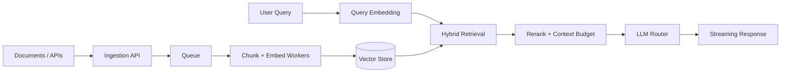
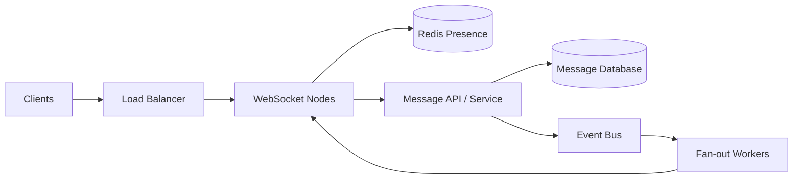
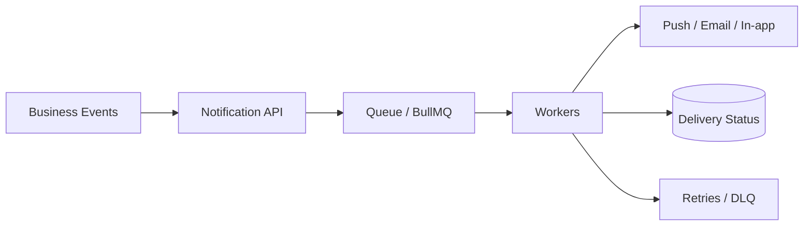

## 👨‍💻 About me

Full Stack Developer with experience building **SaaS platforms, real-time features, AI workflows, background processing pipelines, and cloud-deployed services**. I enjoy understanding bottlenecks, evaluating trade-offs, and building systems that remain maintainable as they grow.

- 🏢 **Software Development Engineer I — ARM Worldwide**
- 🛠️ Previously **Broki Services** and **Specstem Digital**
- 🧠 Interested in **distributed systems, scalable RAG, WebRTC, observability, and reliability**
- 🌱 Currently learning **Go** and deepening my production-engineering skills
- 🎯 Practicing algorithms on **[LeetCode / anie25](https://leetcode.com/u/anie25/)**

## ⚡ My toolkit

 

**Also working with:** Kafka · BullMQ · RabbitMQ · Socket.IO · WebRTC · LiveKit · LangChain · RAG · Vector Search · MCP · REST APIs

## 📊 Live GitHub dashboard

 

> These GitHub cards are served by third-party providers and may be cached or rate-limited.

## 🐍 Animated LeetCode submission calendar

<picture>
  <source media="(prefers-color-scheme: dark)" srcset="https://raw.githubusercontent.com/flutter-create-ani/flutter-create-ani/output/leetcode-snake-dark.svg" />
  <source media="(prefers-color-scheme: light)" srcset="https://raw.githubusercontent.com/flutter-create-ani/flutter-create-ani/output/leetcode-snake.svg" />
  
</picture>

> The animated calendar uses **LeetCode submission activity**, not GitHub commits. It appears after the first successful **Generate LeetCode Submission Snake** workflow run. The visualization follows submission dates; it is not the original Platane/snk cell-eating algorithm. LeetCode's public calendar data and third-party stat cards may sometimes be unavailable.

## 🚀 Engineering experience

| Product / team | What I worked on | Engineering themes |
|---|---|---|
| **ARM Worldwide · Luminary** | Full-stack AI platform, LLM orchestration | Next.js, React, Node.js, LLM routing |
| **Komorebi.fit** | Fitness integrations, device sync, notifications | Terra API, background jobs, event handling |
| **Broki Services · CallHQ.ai** | CRM automation, AI integrations, API improvements | Node.js, RAG, GCP Cloud Run |
| **Specstem Digital** | Backend services and background processing | Express, AWS, BullMQ |

## 🏗️ Architecture lab — how I approach scale

> The following diagrams are **illustrative reference architectures** based on engineering patterns I study and apply. They do not disclose or represent verified internal architectures of employers.

<b>🤖 Scalable RAG: ingestion, retrieval, generation</b>

**Design trade-offs:** Async ingestion isolates spikes but adds processing delay; hybrid retrieval improves recall but costs more; reranking can improve relevance but increases latency; LLM routing controls cost while adding fallback complexity. Evaluate recall, p95 latency, token cost, and answer quality before tuning.

<b>💬 Real-time messaging: delivery and fan-out</b>

**Design trade-offs:** WebSockets provide low-latency bidirectional communication but require connection management; Redis presence is fast but ephemeral; message persistence and idempotent consumers help handle retries and duplicates.

<b>🔔 High-volume notifications: queue-backed delivery</b>

**Design trade-offs:** Queues absorb bursts but introduce eventual consistency. Use idempotency keys, bounded retries, rate limits, and delivery metrics. Monitor queue lag and p95 processing latency.

## 🧪 Currently exploring

**Engineering principle:** *Start simple. Measure real bottlenecks. Scale deliberately. Document trade-offs.*

